# Banco de Dados - Protege ADV & Protege Empresa

Este documento detalha o modelo relacional completo do **Protege ADV & Protege Empresa**, contemplando todas as 39 tabelas implementadas em conformidade com o Anexo I do PRD (Seções 3, 9, 10, 11, 12, 13, 15, 16 e 18).

---

## 1. Relação de Tabelas (39 tabelas)

Abaixo estão todas as 39 tabelas ativas no banco de dados, divididas por módulo de negócio:

### 1.1 Núcleo e Controle de Acesso (RBAC & Multi-tenant)
| Tabela | Descrição |
| :--- | :--- |
| `contas` | Conta/tenant do sistema (escritório, empresa jurídica ou administrador) com isolamento estrito via RLS. |
| `usuarios` | Usuários do sistema vinculados a uma conta e espelhados da tabela de autenticação `auth.users`. |
| `grupos` | Grupos de permissão (ex: Dono, Advogado Sênior, Financeiro) criados por cada conta para controle de acesso. |
| `grupo_permissoes` | Permissões granulares de cada grupo por módulo do sistema (`pode_ver`, `pode_criar`, `pode_editar`, `pode_excluir`). |
| `usuario_grupos` | Associação n-para-n entre usuários e grupos de permissão dentro da conta. |

### 1.2 Processos e Movimentações
| Tabela | Descrição |
| :--- | :--- |
| `processos` | Pastas processuais gerenciadas, com identificador único CNJ de 20 dígitos por conta e preservação de dados oficiais vs manuais. |
| `responsaveis_processo` | Usuários designados como responsáveis ou envolvidos no acompanhamento de determinado processo. |
| `partes_processo` | Partes integrantes do polo ativo, passivo ou outros de um processo, incluindo advogados e vínculo com pessoa. |
| `andamentos` | Movimentações e andamentos processuais cronológicos, capturados de fontes oficiais ou inseridos manualmente. |
| `pedidos_busca` | Fila e estado de requisições de raspagem e sincronização assíncrona de processos por número CNJ. |
| `leituras` | Registro de leitura e ciência de andamentos e publicações por usuário para controle de pendências. |

### 1.3 Monitoramento, Publicações e Diários
| Tabela | Descrição |
| :--- | :--- |
| `empresas_monitoradas` | Empresas e CNPJs monitorados para captura automática de novos processos e distribuições (vínculo opcional com pessoa). |
| `termos_vigiados` | Termos (nomes, advogados, números de OAB ou CNPJs) monitorados nos diários de justiça oficiais. |
| `termo_vigiado_destinatarios` | Usuários da conta configurados para receber avisos imediatos quando um termo vigiado tem resultado. |
| `publicacoes` | Publicações capturadas do DJEN e diários oficiais para triagem, leitura e vinculação processual. |
| `publicacao_termos` | Vínculo associativo entre as publicações capturadas e os termos vigiados que as dispararam. |
| `distribuicoes` | Novas distribuições processuais detectadas na fonte antes da autuação ou citação formal. |

### 1.4 Cadastro Centralizado de Pessoas
| Tabela | Descrição |
| :--- | :--- |
| `pessoas` | Cadastro centralizado de clientes, partes contrárias, advogados e órgãos com tipagem PF/PJ, CPF/CNPJ único e múltiplos perfis. |
| `pessoa_contatos` | Meios de contato e endereços (telefones, WhatsApp, e-mails, endereços postais) vinculados à pessoa. |
| `pessoa_outros_nomes` | Variações fonéticas e grafias alternativas da pessoa para captura nos monitoramentos de DJEN e distribuições. |

### 1.5 Agenda, Compromissos e Feriados
| Tabela | Descrição |
| :--- | :--- |
| `compromissos` | Prazos processuais, audiências e atividades internas vinculáveis a processos e publicações. |
| `compromisso_envolvidos` | Usuários responsáveis ou participantes designados para o compromisso (com herança de RLS do processo). |
| `feriados` | Calendário forense por conta pré-carregado com feriados nacionais e customizado com feriados estaduais, municipais e suspensões de tribunais. |

### 1.6 Gestão Eletrônica de Documentos (GED)
| Tabela | Descrição |
| :--- | :--- |
| `ged_pastas` | Estrutura hierárquica de pastas e subpastas para organização documental, vinculável a processos. |
| `ged_arquivos` | Metadados dos documentos e anexos armazenados no Supabase Storage vinculados a pastas e processos. |
| `ged_versoes` | Histórico cronológico e versionamento de arquivos com tamanho, hash e autor da revisão. |
| `modelos_documento` | Modelos padronizados de peças jurídicas, petições e contratos com variáveis dinâmicas de substituição. |

### 1.7 Contratos de Honorários
| Tabela | Descrição |
| :--- | :--- |
| `contratos` | Contratos de prestação de serviços e honorários com clientes, vigência, renovação automática e criador (`criado_por`), sem campos financeiros (PRD Seção 12 e 18), com RLS restrita via `pode_ver_contrato()`. |
| `contrato_partes` | Clientes contratantes (pessoas), contratados internos e responsáveis associados ao contrato. |
| `contrato_processos` | Associação N:N entre contratos de honorários e processos patrocinados (com restrição dupla de `pode_ver_contrato` e `pode_ver_processo`). |

### 1.8 Notificações e Comunicação
| Tabela | Descrição |
| :--- | :--- |
| `avisos` | Notificações disparadas aos usuários por canal (sistema, e-mail, WhatsApp) com status de entrega e leitura. |
| `preferencias_aviso` | Matriz de preferências de cada usuário determinando quais canais e eventos deseja receber. |

### 1.9 Customização e Metadados
| Tabela | Descrição |
| :--- | :--- |
| `etiquetas` | Etiquetas livres com cores personalizáveis para categorização visual de registros na conta. |
| `etiqueta_vinculos` | Vínculos polimórficos de etiquetas com entidades do sistema (processos, pessoas, etc.). |
| `campos_personalizados` | Definição de campos customizados adicionais configurados pelo usuário para entidades do sistema. |
| `campos_personalizados_valores` | Valores preenchidos para cada campo personalizado em registros específicos. |

### 1.10 Auditoria, Telemetria e Logs
| Tabela | Descrição |
| :--- | :--- |
| `consultas_externas` | Telemetria de chamadas a fontes externas (Datajud, DJEN, APIs de tribunais) com duração e resultado. |
| `registro_atividade` | Trilha de auditoria append-only registrando quem executou cada ação (criar, editar, excluir) no sistema. |
| `registro_acesso` | Log de autenticações, sessões, IPs e segurança de login dos usuários da plataforma. |

---

## 2. Diagrama de Relações Principais (Mermaid)

```mermaid
erDiagram
    contas ||--o{ usuarios : "possui"
    contas ||--o{ grupos : "define"
    contas ||--o{ processos : "gerencia"
    contas ||--o{ pessoas : "cadastra"
    contas ||--o{ compromissos : "agenda"
    contas ||--o{ feriados : "configura"
    contas ||--o{ contratos : "firma"
    contas ||--o{ empresas_monitoradas : "monitora"
    contas ||--o{ termos_vigiados : "cadastra"
    contas ||--o{ publicacoes : "recebe"
    contas ||--o{ distribuicoes : "recebe"
    contas ||--o{ ged_pastas : "organiza"
    contas ||--o{ modelos_documento : "mantem"
    contas ||--o{ etiquetas : "cria"
    contas ||--o{ campos_personalizados : "configura"
    contas ||--o{ consultas_externas : "registra"
    contas ||--o{ registro_atividade : "audita"
    contas ||--o{ registro_acesso : "audita"

    grupos ||--o{ grupo_permissoes : "define permissoes"
    usuarios ||--o{ usuario_grupos : "pertence"
    grupos ||--o{ usuario_grupos : "contem"

    processos ||--o{ responsaveis_processo : "designa"
    usuarios ||--o{ responsaveis_processo : "atribuido a"

    processos ||--o{ partes_processo : "possui"
    pessoas ||--o{ partes_processo : "vinculada a"
    pessoas ||--o{ empresas_monitoradas : "vinculada a"
    pessoas ||--o{ pessoa_contatos : "possui contatos"
    pessoas ||--o{ pessoa_outros_nomes : "possui variacoes"

    processos ||--o{ andamentos : "registra"
    processos ||--o{ pedidos_busca : "solicita"
    processos ||--o{ publicacoes : "vincula"
    processos ||--o{ distribuicoes : "origina"
    processos ||--o{ ged_pastas : "pasta do processo"

    processos ||--o{ compromissos : "vincula prazo/audiencia"
    compromissos ||--o{ compromisso_envolvidos : "designa envolvidos"
    usuarios ||--o{ compromisso_envolvidos : "participa"

    contratos ||--o{ contrato_partes : "define partes"
    pessoas ||--o{ contrato_partes : "contratante"
    usuarios ||--o{ contrato_partes : "contratado/responsavel"
    contratos ||--o{ contrato_processos : "associa"
    processos ||--o{ contrato_processos : "vinculado ao contrato"

    termos_vigiados ||--o{ termo_vigiado_destinatarios : "notifica"
    usuarios ||--o{ termo_vigiado_destinatarios : "recebe alerta"
    termos_vigiados ||--o{ publicacao_termos : "dispara"
    publicacoes ||--o{ publicacao_termos : "gerada por"

    ged_pastas ||--o{ ged_arquivos : "contem"
    ged_arquivos ||--o{ ged_versoes : "versiona"
    usuarios ||--o{ ged_arquivos : "enviado por"

    usuarios ||--o{ leituras : "marca leitura"
    usuarios ||--o{ avisos : "destinatario"
    usuarios ||--o{ preferencias_aviso : "configura"

    etiquetas ||--o{ etiqueta_vinculos : "aplica a"
    campos_personalizados ||--o{ campos_personalizados_valores : "preenche valor"
```

---

## 3. Segurança e Políticas de Isolamento (RLS)

1. **Multi-tenancy:** 100% das 39 tabelas possuem `conta_id` e políticas ativas exigindo `conta_id = conta_atual()`.
2. **Identificação da Sessão:** A função `conta_atual()` obtém a conta do usuário autenticado a partir de `auth.uid()`, impedindo spoofing de tenant.
3. **Funções com Security Definer:** As funções de permissão (`conta_atual()`, `perfil_atual()`, `pode()`, `pode_ver_processo()`) possuem `security definer` e `search_path = public` explícito para evitar recursões infinitas no RLS e ataques de injeção de search path.
4. **Proteção Rigorosa em Contratos:** As políticas das tabelas `contratos`, `contrato_partes` e `contrato_processos` impõem `perfil_atual() in ('dono', 'advogado')`, bloqueando terminantemente perfis `estagiario` e `leitura` de ler, criar, editar ou excluir dados contratuais na camada mais profunda do banco de dados (PRD Seção 3).
5. **Herança de Visibilidade em Agenda:** Compromissos associados a processos e seus envolvidos exigem que o usuário tenha permissão no processo (`pode_ver_processo(processo_id)`), impedindo vazamento de dados de processos restritos.
6. **Trilha de Auditoria Imutável:** A tabela `registro_atividade` opera sob modelo *append-only*, permitindo apenas `SELECT` e `INSERT` para usuários autenticados, com bloqueio total de `UPDATE` e `DELETE`.
7. **Retenção e Expurgo:** A função `expurgar_registros_excluidos()` realiza a limpeza permanente de registros na lixeira com exclusão lógica (`excluido_em`) superior a 30 dias.
